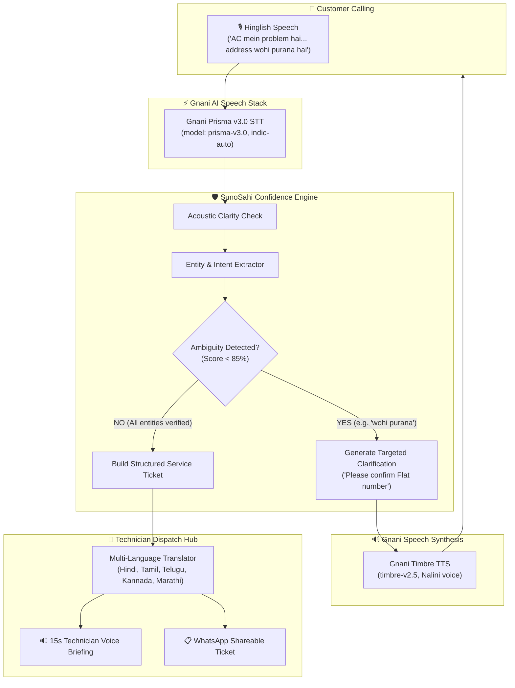

# 🎙️ SunoSahi AI (सुनो सही AI)
### *The Voice Agent That Makes Sure Nothing Gets Lost in Translation*

> **Built for the Gnani Great India AI Hackathon (The Great Indian AI Internship Challenge 2026)**  
> **Technologies Used:** Gnani Prisma v3.0 STT • Gnani Timbre v2.5 / v3.0 TTS • Sovereign Indic NLU Pipeline

---

## 🌟 1. Executive Summary & Problem Statement

Imagine a customer calling an electrician or home appliance technician while stuck in noisy Indian traffic:

> *"Bhaiya, AC mein problem hai... kal se cooling nahi ho rahi. Shaam ko aa sakte ho? Address wohi purana hai."*

### The Real-World Breakdown:
1. **Background Noise:** Street traffic, honking, and noisy ceiling fans degrade standard acoustic speech-to-text models.
2. **Code-Mixed Language:** Indian customers fluidly switch between Hindi, English, and regional Indic languages in the exact same sentence (*"AC mein problem hai... cooling nahi ho rahi"*).
3. **Vague & Ambiguous References:** The customer says *"address wohi purana hai"* (the same old address) and *"shaam ko"* (in the evening).
4. **The Critical Failure of Standard Voice Agents:** Standard LLMs and conversational bots either **guess** the address based on outdated CRM data, hallucinate a time slot, or accept ambiguous input. The result? The technician gets dispatched to the wrong address, wasting ₹500–₹800 in fuel, 45 minutes of transit time, and leaving an upset customer.

---

## 💡 2. The Solution: SunoSahi AI

**SunoSahi AI** (*"Listen Right"* in Hindi) is a **confidence-aware voice dispatch agent** powered by Gnani AI's state-of-the-art Indic speech models. 

Instead of guessing or hallucinating answers, SunoSahi:
- **Understands Code-Mixed Speech:** Uses **Gnani Prisma v3.0** with auto language detection (`indic-auto`) to transcribe conversational Hinglish and Indic dialects accurately even in high background noise.
- **Extracts the Core Problem:** Isolates appliance type (*Air Conditioner*), symptom (*No cooling since yesterday*), and urgency level (*High*).
- **Detects Missing & Ambiguous Entities:** Flags unverified references (e.g., *"wohi purana address"*, vague *"shaam ko"*, or phonetically ambiguous numbers like 15 vs 50).
- **Asks Targeted Clarification:** Proactively and politely clarifies ambiguous slots in natural Hinglish (*"Ji bhaiya, purana address record mein clear nahi hai—kya aap Flat number aur building bata sakte hain? Aur shaam ko 5 se 7 baje ka slot theek rahega?"*).
- **Generates Structured Service Tickets:** Produces a verified, auditable dispatch record.
- **Empowers Field Technicians in Their Mother Tongue:** Converts the ticket into a localized, 3-bullet technical briefing in **Hindi**, **Tamil**, **Telugu**, **Kannada**, **Marathi**, or **English**, complete with a **1-click Voice Briefing powered by Gnani Timbre TTS** and WhatsApp dispatch export.

---

## 🏆 3. Unique Differentiator: Confidence-Aware Conversation

Traditional voice agents operate on binary logic: they transcribe and assume. **SunoSahi AI introduces a Triple-Metric Confidence Engine**:

$$\text{Confidence Score} = (\text{Acoustic Score} \times 0.3) + (\text{Semantic Completeness} \times 0.7) - \text{Ambiguity Penalty}$$

1. **Acoustic Clarity Score (Gnani Prisma):** Signal-to-noise ratio and phonemic certainty.
2. **Entity Completeness Score:** Verifies that Problem, Appliance, Location, and Time window are all concrete.
3. **Disambiguation Matrix:** Penalizes unresolved referents (e.g., *"wohi purana"* $\rightarrow$ -45% penalty) and phonetic number confusions (e.g., 15 vs 50 $\rightarrow$ -40% penalty).

> **Rule:** If Confidence $< 85\%$, SunoSahi is forbidden from finalizing the ticket. It **must** formulate a clarification question.

---

## 🛠️ 4. Gnani AI Technologies & Models Used

| Component | Gnani Model / API | Role in SunoSahi AI |
| :--- | :--- | :--- |
| **Speech-to-Text (STT)** | **Gnani Prisma v3.0** (`https://api.vachana.ai/stt/v3`) | Multilingual Indic ASR with `indic-auto` language detection, robust code-mixed (`format: codemix`) transcription, and acoustic confidence scoring. |
| **Text-to-Speech (TTS)** | **Gnani Timbre v2.5 / v3.0** (`https://api.vachana.ai/api/v1/tts/inference`) | Expressive, natural Indic voice synthesis (`Nalini` voice, `hi-IN` / Indic) for both customer conversational responses and technician voice briefings. |
| **Dialogue Intelligence** | **SunoSahi Sovereign DST Engine** | Ambiguity identification, entity validation, hallucination blocking, and multi-language technical translation. |

---

## 🏗️ 5. System Architecture



---

## 🚀 6. Quick Start & Setup Instructions

### Prerequisites
- Node.js (v18 or higher)
- A valid Gnani AI / Vachana API Key (from [vachana.ai](https://vachana.ai))

### 1. Clone & Enter Directory
```bash
git clone https://github.com/your-username/sunosahi-ai.git
cd sunosahi-ai
```

### 2. Configure Environment
Create or edit `.env`:
```env
GNANI_API_KEY=your_actual_gnani_api_key_here
GNANI_STT_URL=https://api.vachana.ai/stt/v3
GNANI_TTS_URL=https://api.vachana.ai/api/v1/tts/inference
PORT=3000
```
*(Alternatively, launch the web interface and click **Settings** to input your key directly into the UI!)*

### 3. Install Dependencies & Launch
```bash
npm install
npm start
```

Open your browser to:
```
http://localhost:3000
```

---

## 🎯 7. Live Demonstration Guide (Video Recording Flow)

During your 2-minute public demo video:

1. **Step 1: The Ambient Noise Call**  
   - Click **Noise Sim: Traffic & Horns 🚗** to demonstrate acoustic resilience.
   - Click **1️⃣ The AC Problem Brief** preset or speak:
     > *"Bhaiya, AC mein problem hai... kal se cooling nahi ho rahi. Shaam ko aa sakte ho? Address wohi purana hai."*
2. **Step 2: Show the Confidence Inspector**  
   - Highlight how SunoSahi **penalizes unresolved references** (Address: -45% risk).
   - Show how the AI **asks for clarification** instead of guessing the old address!
   - Hear the agent reply out loud powered by **Gnani Timbre TTS**.
3. **Step 3: Customer Clarification**  
   - Click **2️⃣ Customer Clarification** or say:
     > *"Haan, Flat 402, Shanti Vihar, aur 6 baje bhej do."*
   - Notice the ticket status transition immediately to `READY FOR DISPATCH` with **97% High Certainty** and **1 Hallucination Blocked**.
4. **Step 4: Technician View & Multilingual Briefing**  
   - Switch to the **Technician View** tab.
   - Toggle between **हिन्दी**, **தமிழ்**, **తెలుగు**, and **ಕನ್ನಡ**.
   - Click **🔊 Play Voice Briefing for Technician** to demonstrate hands-free audio briefing for mechanics on the move.
   - Click **WhatsApp** to show ready-to-dispatch formatting.

---

## 👥 8. Team & Member Contributions

- **Project Lead & Architecture:** End-to-end design, Gnani Prisma STT & Timbre TTS integration, Confidence-Aware Dialogue Engine, and Multilingual Dispatch UI.

---

## 📜 9. License & Contest Compliance
Developed for the **Gnani Great India AI Hackathon (November 2026)**. All API integrations conform to Gnani AI / Vachana.ai developer specifications.
